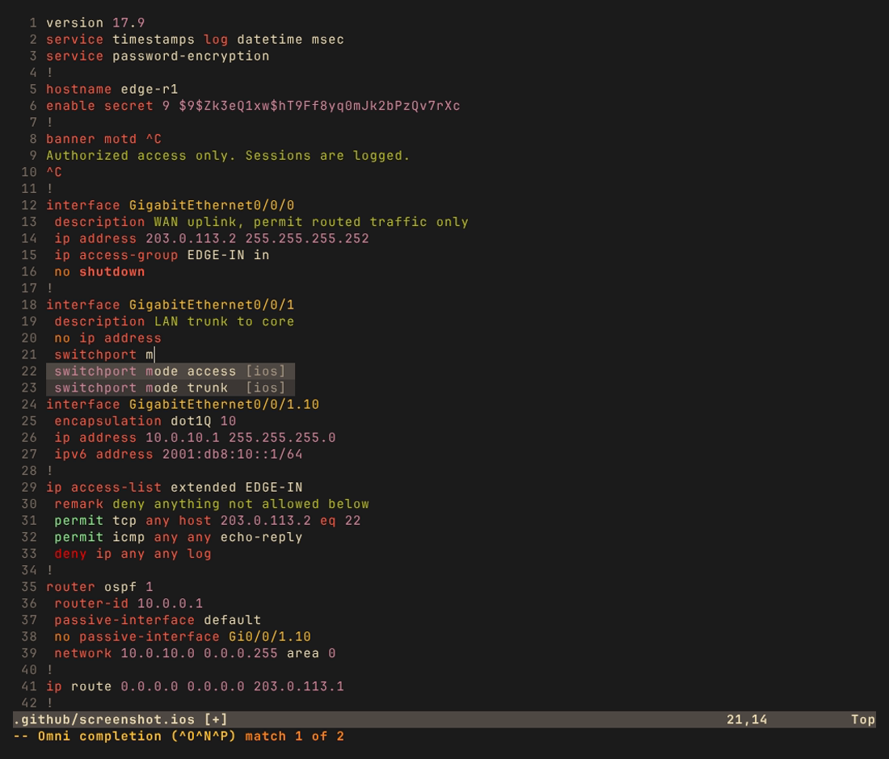

# ios.nvim

ios.nvim adds support for Cisco Internetwork Operating System (IOS) configuration
files to Neovim. It provides filetype detection, syntax highlighting, buffer
settings, omni-completion that follows the enclosing configuration section, and
a set of snippets. Everything except the snippet registration works without a
setup call.



## Requirements

- Neovim. The plugin is developed on Neovim 0.12, and the continuous
  integration (CI) workflow runs the test suite on the current stable and
  nightly releases.
- [LuaSnip](https://github.com/L3MON4D3/LuaSnip) (optional), to load the snippets
  through `setup()`.

## Installation

With [lazy.nvim](https://github.com/folke/lazy.nvim):

```lua
{
  "a-mango/ios.nvim",
  ft = "ios",
  -- only needed to register the snippets with LuaSnip
  config = function()
    require("ios").setup()
  end,
}
```

With the built-in `vim.pack` (Neovim 0.12):

```lua
vim.pack.add({ "https://github.com/a-mango/ios.nvim" })
```

The help file is available under `:help ios.nvim`. Run `:helptags ALL` if the
plugin manager does not generate help tags.

## Filetype detection

The following files are set to the `ios` filetype:

- files with the `.ios` extension,
- files named `*-confg`, which is the default name IOS gives a configuration
  copied over Trivial File Transfer Protocol (TFTP), e.g. `router1-confg`,
- files named `running-config` or `startup-config`.

Files ending in `.cfg`, `.conf` or `.txt` are set to `ios` only when one of
their first 50 lines starts with `version <n>`, `hostname`, `interface`,
`service timestamps`, `Building configuration` or `Current configuration`. Other
files with these extensions keep the filetype Neovim gives them.

## Syntax highlighting

The syntax file highlights comments, section commands at column 0 (`interface`,
`router`, `line`, `ip access-list`, ...), `no` and `default`, `permit`, `deny`
and `shutdown`. It also matches the following values:

- interface names in long and short form (`GigabitEthernet0/0/1`, `Gi1/0/1`,
  `Port-channel1.10`),
- IPv4 addresses, masks and prefixes, IPv6 addresses and Media Access Control
  (MAC) addresses,
- the hash that follows `secret <n>` and `password <n>`,
- banner bodies, whatever the delimiter.

The text after `description` and `remark` is shown as a string, so a word such
as `permit` in an interface description is not highlighted as a keyword. Every
group links to a standard highlight group (`Comment`, `Statement`, `Number`,
...), so the active colorscheme applies.

## Buffer settings

The ftplugin sets `commentstring` to `! %s`, indents by one space (the indent
IOS uses in its own output), folds by indent and adds `-` to `iskeyword` so that
`access-list` or `Port-channel` count as one word. All options are set locally
(`foldmethod` on the window, the others on the buffer) and are reverted when the
filetype changes.

## Completion

`omnifunc` is set, so `<C-x><C-o>` in insert mode completes commands. At column
0 the candidates are global commands (`hostname`, `interface`, `ip route`, ...).
On an indented line, the candidates depend on the section the line belongs to,
i.e. the nearest line above it that starts at column 0 and is not a comment.
The sections covered are `interface`, `router`, `line`, `ip access-list`,
`ipv6 access-list`, `ip dhcp pool`, `route-map`, `vrf`, `class-map`,
`policy-map` and `vlan`. The keyword tables are in `lua/ios/keywords.lua`.

## Snippets

The snippets are stored in VSCode format in `snippets/ios.json` and declared in
`package.json`. `require("ios").setup()` registers them with LuaSnip when it is
installed. Other engines that read VSCode-format snippets can load them from the
plugin directory. The following prefixes are available:

| Prefix   | Expands to                                                                       |
| -------- | -------------------------------------------------------------------------------- |
| `int`    | Routed interface with an IPv4 address                                            |
| `svi`    | Switch Virtual Interface (SVI) for a Virtual Local Area Network (VLAN)           |
| `access` | Access port with PortFast and Bridge Protocol Data Unit (BPDU) guard             |
| `trunk`  | 802.1Q trunk port                                                                |
| `acl`    | Extended named Access Control List (ACL)                                         |
| `ospf`   | Open Shortest Path First (OSPF) process                                          |
| `bgp`    | Border Gateway Protocol (BGP) process with an IPv4 address family                |
| `route`  | Static route                                                                     |
| `vlan`   | VLAN definition                                                                  |
| `ssh`    | Secure Shell (SSH) with local Authentication, Authorization and Accounting (AAA) |
| `ntp`    | Network Time Protocol (NTP) server and syslog host                               |
| `banner` | Message of the day (MOTD) banner                                                 |
| `po`     | Link Aggregation Control Protocol (LACP) port-channel                            |

## Development

The test suite runs headless and needs no other plugin. From the repository
root, run:

```sh
nvim --headless -u NONE --cmd 'set rtp^=.' --cmd 'filetype plugin indent on | syntax on' -l test/run.lua
```

The script prints one `PASS` or `FAIL` line per check and exits with a non-zero
status if any check fails. The Lua sources are linted with
[luacheck](https://github.com/lunarmodules/luacheck), configured in
`.luacheckrc`:

```sh
luacheck lua/ ftdetect/ ftplugin/ test/
```

The screenshot above is rendered with [vhs](https://github.com/charmbracelet/vhs)
from `.github/screenshot.tape`, which opens `.github/screenshot.ios` in a clean
Neovim:

```sh
vhs .github/screenshot.tape
```

## License

MIT. See `LICENSE`.
